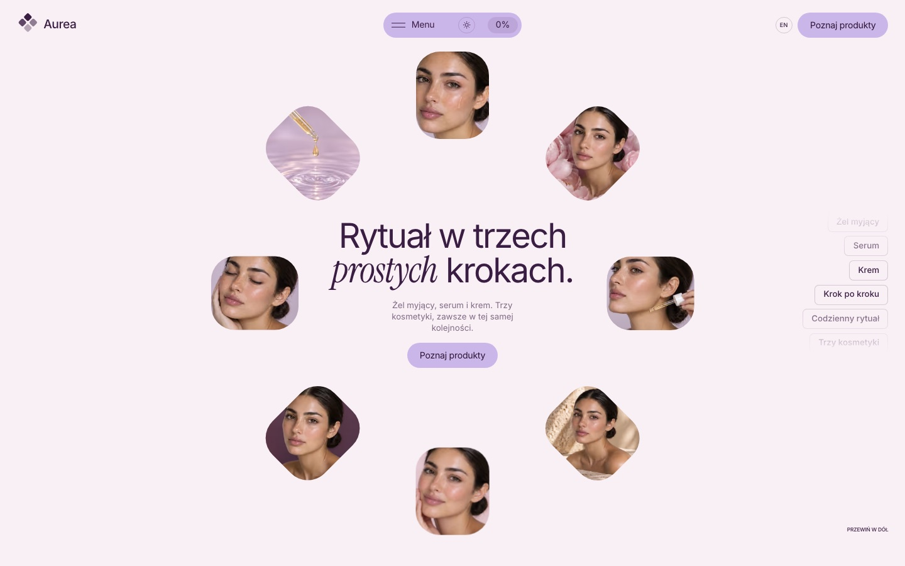
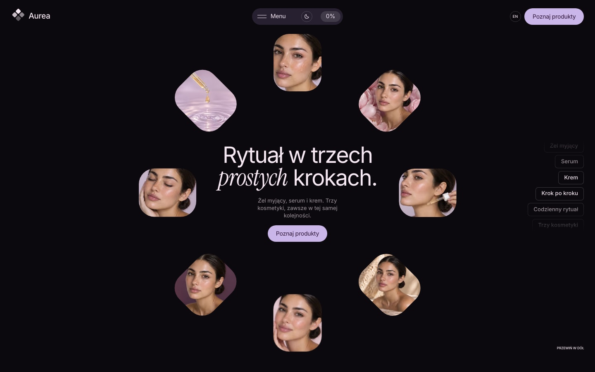
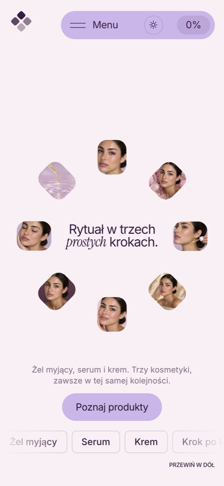

# Aurea

> Rytuał w trzech prostych krokach.

Aurea to strona wizytówka marki kosmetyków do twarzy. Linia ma trzy produkty, które stosuje się zawsze
w tej samej kolejności: 01 żel myjący, 02 serum, 03 krem. Ta kolejność prowadzi przez całą stronę, od hero
przez trzy przypinane slajdy rytuału po osobne podstrony produktów. Strona działa po polsku (pod `/`)
i po angielsku (pod `/en/`). Na tym etapie nie ma sprzedaży online.

Całość to statyczna strona w Astro 7 z animacjami w GSAP. Fonty, skrypty i zdjęcia są hostowane lokalnie,
więc strona nie wysyła żadnych zapytań do obcych serwerów i nie potrzebuje banera cookies.



## Stan projektu

Strona jest w budowie i nie została jeszcze opublikowana.

- **Zdjęcia.** Część kadrów miała na opakowaniach napis innej marki i została usunięta. W ich miejscu
  strona pokazuje kafelek z nazwą pliku, np. `[[styled-0.webp]]`. Brakuje 17 kadrów.
- **Logo.** Cztery romby to znak zastępczy.
- **Dane.** Ceny i pojemności są potwierdzone. Składy INCI, okresy trwałości po otwarciu, opisy „dla kogo”,
  teksty o marce i dane firmy to propozycje do potwierdzenia. Adres, NIP, REGON, telefon i hosting zostają
  jako pola `[[...]]`.
- **Domena.** `astro.config.mjs` ma tymczasowy adres `https://aurea.example`.

## Dla kogo

- **Dla klientek i klientów marki**, którzy chcą szybko zrozumieć, co kupują i w jakiej kolejności tego
  używać. Każdy produkt ma pojemność, cenę, trwałość po otwarciu, sposób użycia i skład.
- **Dla właściciela marki**, który potrzebuje spokojnej, dopracowanej wizytówki przed startem sprzedaży.
  Treść w obu językach jest w kilku plikach TypeScript, bez CMS-a.
- **Dla dewelopera**, który przejmie projekt. Kod jest mały, typowany i pokryty testami e2e uruchamianymi w CI.

To nie jest sklep. Nie ma koszyka, płatności ani kont użytkowników. Sklep to osobny, późniejszy etap.

## Jak to działa

```
src/i18n/ui.ts          teksty interfejsu PL i EN
src/data/products.ts    produkty i slajdy rytuału        ──►  src/views/*.astro  ──►  astro build  ──►  dist/
src/data/photos.ts      opisy alt i kadrowanie zdjęć          (wspólne dla obu         (statyczny HTML,
src/legal/documents.ts  polityka prywatności, regulamin        języków)                 AVIF + WebP, sitemap)
                                                                      ▲
                                                     src/pages/*  cienkie trasy PL i EN
```

**Zdjęcia** trafiają na stronę w dwóch krokach:

1. Arkusze z kilkoma kadrami leżą w `zrodla/arkusze/` (poza gitem). `npm run photos` tnie je na pojedyncze
   pliki WebP w `src/assets/photos/`.
2. Komponent `Photo.astro` robi z każdego pliku obraz w AVIF i WebP z `srcset`. Jeśli pliku nie ma, pokazuje
   kafelek z jego nazwą, więc wystarczy wrzucić plik o tej nazwie i przebudować stronę.

**Ikony** powstają ze znaku: `npm run icons` generuje `favicon.ico`, `apple-touch-icon.png` i obraz
Open Graph `og.png` (1200x630) w `public/`.

**Ruch:** preloader z licznikiem pokazuje się tylko przy pierwszej wizycie (ok. 1,6 s). Hero ma pierścień
zdjęć, a rytuał trzy przypinane slajdy. Przy `prefers-reduced-motion` animacje są wyłączone, a treść widać
od razu.

## Funkcje

| Polski | Angielski | Co to jest |
|---|---|---|
| `/` | `/en/` | Hero z pierścieniem zdjęć, filozofia, linia trzech produktów, rytuał w trzech slajdach, końcowe wezwanie |
| `/produkty/zel-myjacy/` | `/en/products/cleansing-gel/` | Krok 01: pojemność, cena, trwałość, jak stosować, skład INCI, dla kogo, gdzie kupić |
| `/produkty/serum/` | `/en/products/serum/` | Krok 02, ten sam układ, link do następnego kroku |
| `/produkty/krem/` | `/en/products/cream/` | Krok 03 |
| `/o-marce/` | `/en/about/` | Historia marki i produkcja |
| `/polityka-prywatnosci/` | `/en/privacy-policy/` | Polityka prywatności zgodna z RODO |
| `/regulamin/` | `/en/terms/` | Regulamin strony |
| każdy inny adres | | Własna strona 404 z `noindex` |

Do tego `sitemap.xml`, `robots.txt`, canonical i hreflang na każdej podstronie, motyw dzienny i nocny,
przełącznik języka prowadzący do odpowiednika strony i link „Przejdź do treści”.

## Zrzuty ekranu

| Motyw nocny | Telefon |
|---|---|
|  |  |

Zrzuty pozostałych sekcji i podstron dojdą razem z nowymi zdjęciami.

## Uruchomienie

Wymagany Node.js 22.23 lub nowszy (CI używa Node 26).

```bash
npm ci
npm run dev
```

Podgląd działa pod `http://127.0.0.1:4710`. Projekt nie ma zmiennych środowiskowych ani pliku `.env`.

| Skrypt | Co robi |
|---|---|
| `npm run dev` | Serwer deweloperski na porcie 4710 |
| `npm run build` | Statyczny build do `dist/` |
| `npm run preview` | Podgląd zbudowanej strony |
| `npm run check` | Sprawdzenie typów i szablonów (`astro check`) |
| `npm run test:e2e` | Build i testy e2e w Playwright |
| `npm run photos` | Cięcie arkuszy z `zrodla/arkusze/` na pojedyncze zdjęcia |
| `npm run icons` | Favicon, ikona Apple i obraz Open Graph ze znaku |

Przed pierwszym `npm run test:e2e` zainstaluj przeglądarkę:

```bash
npx playwright install chromium
```

## Testy i CI

Testy e2e w `tests/e2e/` same budują stronę i uruchamiają `astro preview` na porcie 4711. Każdy test
przechodzi dwa razy: na desktopie (1728x1000) i na telefonie (375x812). Sprawdzają:

- każdą z 14 podstron: status, język, tytuł, opis, jeden `h1`, canonical i hreflang, brak poziomego
  przewijania, atrybuty `alt`, uszkodzone obrazy i błędy w konsoli
- unikalne tytuły i opisy w obrębie języka, stronę 404, sitemapę i `robots.txt`
- menu z klawiszem Escape, przełącznik języka, motyw nocny po przeładowaniu, link „Przejdź do treści”
- preloader tylko przy pierwszej wizycie i tryb ograniczonego ruchu

GitHub Actions (`.github/workflows/ci.yml`) przy każdym pushu i pull requeście na `main` uruchamia
`npm ci`, `npm run check` i `npm run test:e2e`. Przy błędzie wyniki Playwrighta zostają jako artefakt
na 7 dni.

## Treść i zdjęcia

| Co zmienić | Gdzie |
|---|---|
| Teksty interfejsu w obu językach | `src/i18n/ui.ts` |
| Produkty, ceny, składy, slajdy rytuału | `src/data/products.ts` |
| Nazwa firmy, e-mail | `src/data/site.ts` |
| Polityka prywatności i regulamin | `src/legal/documents.ts` |
| Opisy alt i punkt kadrowania zdjęć | `src/data/photos.ts` |
| Adresy podstron | `src/i18n/routes.ts` (nowa podstrona trafia też do `tests/e2e/pages.ts`) |
| Logo | symbol `#logo` w `src/components/Sprite.astro`, potem `npm run icons` |
| Kolory i rozmiary | tokeny w `src/styles/global.css` |
| Domena | `site` w `astro.config.mjs` |

Każda zmiana treści idzie w obu językach. Zdjęcia wygenerowane przez AI nie mogą być przedstawiane jako
efekty działania kosmetyku.

## Struktura katalogów

```
.github/workflows/   CI
docs/screenshots/    zrzuty do README
public/              fonty woff2, favicon, ikona Apple, og.png
scripts/             cięcie arkuszy zdjęć, generowanie ikon
src/
  assets/photos/     zdjęcia WebP (źródło dla AVIF i WebP z srcset)
  components/        nagłówek, menu, stopka, preloader, zdjęcie, sprite SVG
  data/              produkty, zdjęcia, dane firmy
  i18n/              teksty i adresy PL i EN
  layouts/           Base.astro: head, meta, nagłówek, stopka
  legal/             treść dokumentów prawnych
  pages/             trasy PL, trasy EN pod en/, sitemap i robots
  scripts/           motyw, menu, preloader, hero, slajdy rytuału
  styles/            global.css z tokenami
  views/             widoki wspólne dla obu języków
tests/e2e/           testy Playwright
```

## Prywatność i bezpieczeństwo

- Brak zewnętrznych zapytań: Inter i Instrument Serif w `public/fonts/`, GSAP z npm w bundlu, zdjęcia lokalnie.
- Brak ciasteczek. W `localStorage` zapisują się tylko dwie wartości niezbędne do działania strony: wybrany
  motyw (`aurea-light`) i informacja, że preloader już się wyświetlił (`aurea_preloader_v1`).
- Brak formularzy, backendu i sekretów. Pliki agentów AI, `.env`, klucze i `zrodla/` są w `.gitignore`.

## Przed publikacją

- potwierdzić albo podmienić dane proponowane i uzupełnić pola `[[...]]` (adres, NIP, REGON, telefon, hosting)
- porównać teksty „Jak stosować” i składy INCI z etykietami od producenta receptury
- wgrać zdjęcia z opakowaniami Aurea i logo, potem `npm run icons`
- ustawić docelową domenę w `astro.config.mjs`
- sprawdzić znak towarowy „Aurea” w klasie 3 (UPRP, EUIPO)

## Licencja

Kod na licencji MIT, szczegóły w pliku [LICENSE](LICENSE). Copyright (c) 2026 Szymon Kaczmarczyk.
Nazwa marki, logo i zdjęcia nie są objęte licencją MIT.
